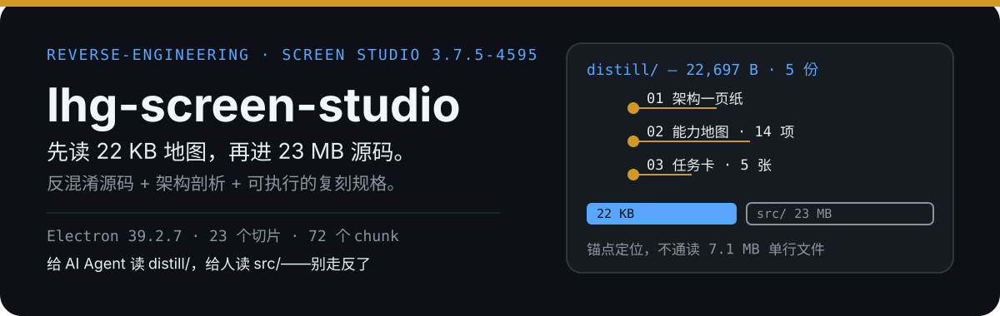

<p align="center">
  
</p>

# lhg-screen-studio

> **Screen Studio 3.7.5-4595 的逆向学习包**：完整反混淆源码 + 架构剖析 + 可执行的复刻规格。
> 给 AI Agent 读的是 `distill/`（22,697 B，本地实测）；给人读的是 `src/`（23 MB，本地实测）。

**这是什么**：Screen Studio 是 macOS 上一款录屏美化工具（自动缩放、光标平滑、背景合成）。本仓库是它 **3.7.5-4595** 版本的逆向产物——学思路、学架构、学算法，不搬代码、不搬素材。

| 项目 | 值 |
|---|---|
| 应用 | Screen Studio 3.7.5-4595 · Electron 39.2.7 · `com.timpler.screenstudio` |
| 主进程 | `dist-electron/index.js` 7,484,678 B（esbuild bundle + javascript-obfuscator） |
| 渲染进程 | `dist/*.js` 72 个 Vite chunk（同样混淆，本地实数） |
| 反混淆 | 字符串数组 + 下标解码器 + 轮转 IIFE → 在 `node:vm` 里实际执行后回填，主进程替换 **80,221** 处 |
| 归属分析 | 用 `node_modules/` 132 个包的源码做字符串指纹，把 538 个代码块归到 28 个目录 |
| 应用自身代码 | **1.33 MB**（其余 5.8 MB 是 sentry/qs/ajv 等第三方） |

**详细方法与可信度分级见 [`REVERSE-ENGINEERING.md`](REVERSE-ENGINEERING.md)。**

## 快速开始：如果你是 AI Agent，从这里开始

你有两条路，**不要走错**：

```bash
git clone https://github.com/lhg-projects/lhg-screen-studio.git
cd lhg-screen-studio
cat distill/01-ARCHITECTURE-1PAGE.md   # 先读这一份，5 KB，建立全景
```

### 路线 A：学架构、写规格（推荐，token 便宜）

```
1. 读 distill/01-ARCHITECTURE-1PAGE.md      ← 建立全景（5 KB）
2. 读 distill/02-CAPABILITY-MAP.md          ← 14 项能力拆解（7.5 KB）
3. 用自己的话复述一遍，确认理解无误
4. 需要动手时，读 distill/03-PROMPT-CARDS.md，按卡执行
```

**总成本 ≈ 1 万 token，信息密度 >90%。**

### 路线 B：查具体实现（贵，但精确）

只有当你需要确认某个函数的确切行为时才用：

```
刻意搜索 → 不要通读
index/anchors.md         告诉你搜什么词
src/main/slices/*.js     23 个功能切片，每片带 ▼ANCHOR 定位标记
src/renderer/*.js        72 个 Vite chunk
```

### ⛔ 三条硬规则

| 不要 | 为什么 |
|---|---|
| 通读 `src/main/index.deobfuscated.js`（7.1 MB 单行） | 80 万 token，噪音淹没信号，你会幻觉 |
| 试图“把 bundle 翻译成 TypeScript” | 标识符是 `_0x1a2b3c`，你只能猜，猜就是编 |
| 跳过 `distill/` 直接看代码 | 顺序反了。先有地图再走路 |

**正确姿势：按规格在新代码库里实现，而不是转写旧代码。**

## 目录

```
.
├── README.md                    ← 你在这里
├── REVERSE-ENGINEERING.md       还原方法、可信度分级、已知坑
├── ARCHITECTURE.md              架构剖析（8 章，带代码位置）
├── AGENTS.md                    给 AI Agent 的工作守则
├── llms.txt                     LLM 索引（llmstxt.org 规范）
│
├── distill/                     ★ 给 AI 的蒸馏包（22,697 B，优先读这个）
│   ├── 00-README.md             怎么用这个包
│   ├── 01-ARCHITECTURE-1PAGE.md 一页纸架构
│   ├── 02-CAPABILITY-MAP.md     14 项能力 → 实现 → 关键点
│   ├── 03-PROMPT-CARDS.md       5 张可粘贴任务卡
│   └── 04-BOUNDARIES.md         能学什么 / 别碰什么
│
├── index/                       检索层
│   ├── api-surface.md           主进程能力清单（按 9 组业务分组）
│   ├── anchors.md               「想找什么 → grep 什么」速查表
│   └── inventory.json           机器可读清单
│
├── src/
│   ├── main/
│   │   ├── index.deobfuscated.js  主进程全文（7.1 MB，权威副本）
│   │   ├── slices/                23 个功能切片（★ 学习主战场）
│   │   └── blocks/                538 块，按归属包分 28 个目录
│   ├── preload/                   桥接层（562 KB）
│   └── renderer/                  72 个 chunk
│
└── tools/                       可复现脚本（反混淆 / 切分 / 指纹 / 切片）
```

## 三个最值得学的点

**① IPC 用 electron-trpc，不写裸通道**
主进程能力 = 一棵 tRPC router，渲染进程 `trpc.project.readProject.query()`。换来类型安全 + 批量 + 订阅。

**② 授权 fail-open**
本地 JWT 只做 `decode + zod`，不验签；判定靠服务端；网络异常时 `catch → assuming correct → allow`。断网可用是硬需求，代价是阻断域名即永久激活。

**③ 缩放区间是产品灵魂**
`ZoomRange { type:'auto'|'manual', sourceStartTime, sourceEndTime, target }` + 光标停留/点击启发式 + 缓动曲线。**这是它值钱的全部，其余都是工程量。**

## 边界

学思路、学架构、学算法 —— 这些是知识。
但 `assets/` 里的字体、音效、插画、背景素材是**资产**，不随代码授权。详见 [`distill/04-BOUNDARIES.md`](distill/04-BOUNDARIES.md)。

## 复现

```bash
# 从 app.asar 重新生成全部产物
cd tools/
node deobfuscate.cjs <主进程 bundle> out.js       # 字符串数组反混淆
node batch-renderer.cjs                            # 渲染进程批量
node analyze.cjs                                   # AST 顶层块
node fingerprint.cjs                               # 按 node_modules 归属
node make-slices.cjs                               # 功能切片
node extract-api.cjs                               # 能力清单
```

---

*生成于 2026-10-22。样本版本 3.7.5-4595。仅用于架构学习研究。*
